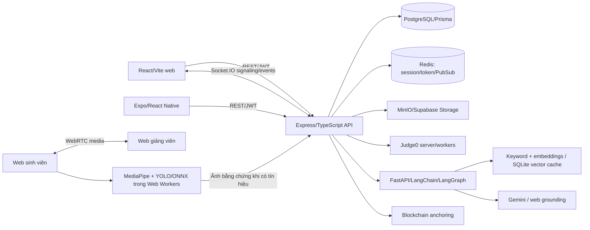

# Performance Audit — SOES

Ngày đánh giá: 26/11/2026. Revision: `7f5302c` trên `develop`.

**Trạng thái: chỉ đánh giá; chưa triển khai tối ưu source code.** Báo cáo này là đầu vào để phê duyệt kế hoạch, không phải chứng nhận khả năng chịu tải.

## 1. Phạm vi và cách đọc kết quả

- Đã kiểm kê cấu trúc backend, frontend web, mobile, AI Agent, schema PostgreSQL, Redis, Socket.IO/WebRTC, storage và Judge0. Có 1.037 đường dẫn trong các thư mục source được kiểm kê; không có nghĩa từng file đã được review thủ công toàn bộ.
- Review sâu tập trung vào đường đi bắt đầu thi → tải đề → lưu đáp án → heartbeat/giám sát → nộp → chấm → công bố điểm; các luồng RAG, chatbot, sinh bài luyện và sinh câu hỏi/đề cho giảng viên.
- Bỏ qua dependencies, mã vendor/generated, build/cache và các thư mục `outputs/`, `research/`, `artifacts/`. Chỉ đọc cấu hình cần thiết để hiểu runtime; không đưa khóa bí mật, dữ liệu sinh viên hoặc nội dung bài làm vào báo cáo.
- Thực hiện kiểm tra tĩnh, test cô lập và benchmark local nhỏ. Sau yêu cầu bổ sung của người dùng, đã khởi động API `3000` và AI Agent `8001`, đo endpoint chỉ đọc và bốn request AI dùng dữ liệu kiểm thử tự tạo. Không tạo lượt thi hoặc lưu bài làm thử trong database hiện có.
- **[CODE]**: bằng chứng trực tiếp từ source. **[MEASURED]**: số đo trong phiên đánh giá. **[HYPOTHESIS]**: tác động/rủi ro chưa được tái hiện bằng tải nghiệp vụ. **[PROPOSED]**: giải pháp hoặc tiêu chí chưa triển khai.
- Không dùng bộ dữ liệu 600 request trong `research/` làm benchmark thực nghiệm. Không dùng log/số liệu lịch sử trong hội thoại như số đo của revision hiện tại.

## 2. Kiến trúc và luồng nghiệp vụ hiện tại

Backend là **modular monolith**, không phải toàn bộ hệ thống microservices. Các module học vụ, người dùng, ngân hàng câu hỏi, duyệt đề, ca thi, bài làm, điểm/phúc khảo và phân tích được tổ chức theo controller/service/repository. AI Agent và Judge0 là dịch vụ riêng. PostgreSQL lưu dữ liệu nghiệp vụ; Redis phục vụ xác thực, realtime adapter và phiên live; storage lưu tài liệu/bằng chứng.

API bắt đầu thi tạo `ExamAttempt`, tiêu thụ face grant, khóa phân phối đề nếu cần, tạo phiên và snapshot thứ tự câu hỏi. Mã tại `attempt.repository.ts:188` đã đưa đọc danh sách ID câu hỏi ra trước transaction và dùng `createMany`; đây là cải thiện có sẵn. Submit chuyển trạng thái bằng conditional update rồi trả HTTP trước khi chấm. Đáp án/đề đã mã hóa vẫn phải giữ nguyên yêu cầu bảo mật trong mọi tối ưu.

MediaPipe và YOLO chạy trên máy sinh viên; tăng số sinh viên không đồng nghĩa server phải inference toàn bộ webcam. Chi phí server tăng ở heartbeat, sự kiện, upload và storage. WebRTC truyền media giữa peer, Socket.IO chủ yếu chuyển signaling/sự kiện; TURN, khi được cấu hình và sử dụng, có chi phí băng thông riêng.

Docker Compose cung cấp PostgreSQL 16, Redis 7, MinIO, Judge0 và database riêng cho Judge0; API, web, Agent chạy ngoài Compose theo scripts. Compose hiện không chứng minh có HA, giới hạn tài nguyên production, autoscaling hoặc observability đầy đủ.

### Điểm đang làm tốt cần giữ lại

- Prisma Client dùng một instance tại `be/soes-be/src/lib/prisma.ts:3`.
- Unique constraint cho lượt thi, đáp án/câu và thứ tự snapshot; submit/auto-submit dùng cập nhật có điều kiện.
- Kết quả điểm tuân theo release policy; không được cache vượt phạm vi quyền truy cập/công bố.
- Redis adapter đã có sẵn; gateway kiểm tra quyền vào room. Các hook live đã có `off`, đóng peer, timer cleanup.
- MediaPipe/YOLO tách worker; frame được chuyển ownership và đóng; có busy guard và fallback CPU cho face task.
- Monaco và Face Liveness đã có lazy component; không thể kết luận tất cả dependency nặng đều tải ngay.
- Cache tài liệu Node giới hạn 32 MiB/8 entry/10 phút; cache text Python giới hạn 16 MiB/16 entry/15 phút. RAG có index theo nội dung/model, lock cùng key trong tiến trình và keyword fallback.
- Analytics giới hạn 51 lượt của sinh viên, 501 lượt của giảng viên, sau đó báo giới hạn phạm vi; không phải truy vấn lịch sử vô hạn.

## 3. Danh sách phát hiện và thứ tự ưu tiên

Severity đánh giá hậu quả, không phải mức độ chắc chắn hệ thống đã lỗi trên production. **High**: ảnh hưởng trực tiếp lưu bài, chấm, độ tin cậy hoặc tải đường thi. **Medium**: tác động tăng theo dữ liệu/tải. **Low**: debt hoặc tối ưu phụ. Không có phát hiện nào được gắn Critical chỉ dựa vào giả thuyết tải.

| ID | Mức độ | Vấn đề | Độ phức tạp đề xuất |
|---|---|---|---|
| F01 | High | Autosave gửi toàn bộ đáp án, debounce có thể bị bỏ qua | Vừa |
| F02 | High | Lưu đáp án và kết thúc bài chưa cùng bảo vệ bằng trạng thái atomic | Vừa |
| F03 | High | Chấm nền không durable, thiếu giới hạn tổng tác vụ | Vừa–cao |
| F04 | High | Chấm từng đáp án tuần tự trong transaction | Vừa |
| F05 | High | Job hết giờ batch nhỏ và chỉ khóa trong một tiến trình | Vừa |
| F06 | Medium | Đường job thiếu composite index phù hợp | Thấp–vừa |
| F07 | High | Danh sách bài nộp phân trang sau khi tải toàn bộ nội dung | Vừa |
| F08 | Medium | Điểm số/lịch thi tải toàn bộ rồi xử lý ở Node | Vừa |
| F09 | Medium | Polling trạng thái song song Socket.IO; render theo từng heartbeat | Thấp–vừa |
| F10 | High | Redis live session đọc–sửa–ghi không atomic | Vừa |
| F11 | Medium | Redis KEYS và phục hồi kết nối hạn chế | Thấp–vừa |
| F12 | High | Giới hạn AI theo request, thiếu admission control toàn dịch vụ | Vừa |
| F13 | Medium | Cache tài liệu có cold-miss stampede và dữ liệu lặp qua HTTP | Thấp–vừa |
| F14 | Medium | RAG index cục bộ và tính similarity Python trên request | Vừa |
| F15 | High | Một số đường tăng tốc đã làm yếu kiểm chứng bài AI | Vừa |
| F16 | Medium | Router web import đồng bộ nhiều màn hình | Thấp |
| F17 | Medium | YOLO nhiều lượt inference và cấp phát tensor mỗi scan | Vừa |
| F18 | Medium | Upload bằng chứng buffer RAM, queue/lỗi mạng chưa bền | Vừa |
| F19 | Medium | Chưa đủ điều kiện vận hành nhiều API replica | Vừa |
| F20 | Medium | Thiếu số đo vận hành và readiness đầy đủ | Thấp–vừa |
| F21 | Medium | Quality gates/dependency cài đặt và module quá lớn | Vừa, làm dần |
| F22 | Low | Candidate pool sinh đề được giới hạn sau khi tải | Thấp–vừa |

### F01 — Autosave khuếch đại request và mất tác dụng debounce

**[CODE] Vị trí:** `fe/soes-fe/src/pages/student/hooks/take-exam/useTakeExam.ts:69`, `:95`, `:104`; `fe/soes-fe/src/pages/student/StudentTakeExamPage.tsx:390`; `fe/soes-fe/src/pages/student/api/student-take-exam.api.ts:317`.

`saveAnswersToServer` phụ thuộc `answers`, nên đổi identity khi gõ/chọn đáp án. Effect autosave lại phụ thuộc callback này ngoài `debouncedAnswers`, có thể chạy ngay khi answers đổi. Hàm format toàn bộ đáp án và API `Promise.all` PUT từng câu, bao gồm câu không đổi. Tra cứu câu bằng `session.questions.find` trong vòng duyệt đáp án còn tạo O(A×Q) xử lý local.

**Ảnh hưởng:** một thay đổi với A câu đã làm có thể tạo A PUT, mỗi PUT lại xác thực, đọc bài, upsert đáp án và cập nhật cùng row attempt. Request chồng nhau có thể ghi đè phiên bản code mới bằng response/request cũ khi mạng chậm.

**[PROPOSED]** theo dõi dirty question và revision, một save đang chạy, hợp nhất thay đổi mới; effect thực sự chờ debounce. Thiết kế batch API chỉ nhận câu đổi với giới hạn kích thước/số câu. Khi nộp phải flush revision cuối đã được server xác nhận. Dùng Map tra ID nếu profiling cho thấy cần.

**Lợi ích:** giảm network/DB write và tranh chấp row. **Rủi ro:** mất draft khi điều hướng nếu flush sai. **Nghiệm thu:** gõ liên tục không tạo mỗi keystroke một đợt save; sửa một câu không gửi lại cả đề; mạng đảo thứ tự không làm mất revision cuối; submit/refresh giữ đúng dữ liệu. Đo request và DB statements trước/sau trên cùng kịch bản.

### F02 — Race giữa save và submit/force-submit

**[CODE] Vị trí:** `be/soes-be/src/modules/student-take-exam/services/student-take-exam.service.ts:688`; `repositories/attempt-answer.repository.ts:28`; `repositories/attempt.repository.ts:252` trong cùng module.

Service đọc/kiểm tra `IN_PROGRESS` và deadline trước, nhưng transaction save chỉ upsert câu trả lời và update attempt theo `id`, không kiểm tra lại trạng thái. Submit/force-submit có thể thắng giữa bước kiểm tra và bước ghi; grading cũng có thể đọc snapshot khác với dữ liệu save tới muộn. `version` được tăng nhưng ở đường save này chưa dùng như điều kiện optimistic concurrency.

**[HYPOTHESIS]** race có cơ sở từ code, chưa tái hiện bằng test cạnh tranh DB thật trong audit này. Đây là vấn đề đúng đắn dữ liệu, không giải quyết bằng chỉ tăng timeout.

**[PROPOSED]** serialize thay đổi trên row attempt, kiểm tra status/deadline và revision trong cùng transaction trước khi ghi đáp án; đảm bảo submit tạo ranh giới snapshot cuối nhất quán. Chọn row lock hoặc conditional update có kết quả được kiểm tra và cùng transaction; không tự động đổi isolation toàn hệ thống.

**Lợi ích:** dữ liệu chấm ổn định. **Rủi ro:** deadlock nếu thứ tự khóa không thống nhất. **Nghiệm thu:** test save đồng thời submit, hết giờ và buộc nộp, hàng trăm lần lặp; không ghi đáp án sau trạng thái đóng, không chấm snapshot một phần, retry không nhân đôi tác dụng.

### F03 — Chấm nền nằm trong tiến trình và không có backpressure tổng

**[CODE] Vị trí:** `student-take-exam.service.ts:153` (`continueAfterAttemptEnded`), `:810`; `services/programming-grading.service.ts:10`, `:37`; `be/soes-be/src/lib/judge0.ts:195`.

Async IIFE được gọi bằng `void` sau chuyển trạng thái. Nếu API dừng, công việc chưa xong mất trong bộ nhớ; catch chỉ ghi log. Job hết giờ chỉ chọn `IN_PROGRESS`, không phải cơ chế phục hồi bài đã chuyển `SUBMITTED` nhưng chấm dở. Mỗi bài giới hạn 5 test đồng thời nhưng nhiều bài submit vẫn tạo nhiều nhóm 5; không có limiter toàn dịch vụ. Poll Judge0 mỗi 800 ms, mỗi testcase submit riêng, nhân chi phí biên dịch/poll.

GET poll ở `judge0.ts:229` không truyền AbortSignal; timeout vòng while không hủy được một fetch đang treo, nên không phải deadline chặt cho toàn thao tác.

**[PROPOSED]** lưu trạng thái job/outbox cùng transaction submit, worker claim có lease và idempotency, retry có giới hạn và cơ chế phục hồi; giới hạn tổng Judge0 đang chạy và tách quota chạy thử với chấm chính thức. Trước khi thêm thư viện queue mới, cân nhắc bảng job/outbox PostgreSQL hiện có. Thêm deadline/cancel cho từng poll; xem batch API hiện đã có thay vì tăng Promise.all vô hạn.

**Lợi ích:** trả submit nhanh nhưng chấm vẫn hoàn tất sau restart; bảo vệ CPU Judge0/DB. **Rủi ro:** chấm hai lần, ghi đè chấm tay nếu job không có version. **Nghiệm thu:** kill worker giữa chấm rồi khởi động lại, mỗi bài hoàn tất đúng một kết quả logic; SYSTEM_ERROR không tự biến thành sai bài; không vượt concurrency cấu hình; theo dõi queue age và thời gian từ submit đến chấm xong.

### F04 — Transaction chấm trắc nghiệm có N lượt ghi tuần tự

**[CODE] Vị trí:** `repositories/attempt-grading.repository.ts:15`, `:31`, `:47` của module student-take-exam.

Trong interactive transaction, tải các câu/options và đáp án, giải mã options rồi `await tx.studentAnswer.update` cho từng câu. Đây là N writes theo số câu trả lời, không phải một bulk write. Kéo dài thời gian chiếm connection và tăng nguy cơ timeout khi nộp đồng loạt. Các select/include rộng hơn dữ liệu tối thiểu cho tính điểm.

**[PROPOSED]** đọc đúng projection, tính điểm trên snapshot bất biến, gom cập nhật phù hợp PostgreSQL/Prisma rồi chốt tổng có version trong transaction ngắn. Nếu cần SQL bulk, dùng tham số hóa và test điểm từng dạng; không đổi quy tắc chấm đa lựa chọn trong một task hiệu năng.

**Lợi ích:** giảm round-trip và pool occupancy. **Rủi ro:** thay đổi precision Decimal hoặc điểm phúc khảo. **Nghiệm thu:** cùng bộ bài trước/sau cho điểm/status giống nhau; số round-trip ghi không tăng tuyến tính từng câu; đo p95 transaction trên đề 20/50/100 câu và khi nộp đồng thời.

### F05 — Job hết giờ giới hạn 50 bài/lượt và khóa process-local

**[CODE] Vị trí:** `be/soes-be/src/jobs/exam-attempt.jobs.ts:7`, `:9`, `:34`; `student-take-exam.service.ts:218`; `repositories/attempt.repository.ts:332`. `exam-anchor.jobs.ts:8` cũng dùng cờ process-local.

Mỗi 15 giây gọi xử lý hết giờ, tối đa 50 bài, duyệt tuần tự. `running` chỉ ngăn overlap trong một process, không giữa API replica. Conditional update hiện giúp ngăn chuyển trạng thái một bài hai lần nhưng không loại bỏ truy vấn và công việc tranh chấp. `markStaleExamSessionsOffline` tải danh sách stale không giới hạn rồi Promise.all update mỗi session (`attempt-session.repository.ts:41`, `:59`).

**Mô hình suy luận, không phải benchmark:** nếu chỉ job này xử lý, mỗi lượt hoàn tất dưới 15 giây và hết đúng 50 bài, trần lấy việc theo cấu hình là 200 bài/phút; 5.000 bài cùng hết giờ cần 100 lượt, khoảng 25 phút để quét hết. Request từ client và thời gian thực thi làm thực tế khác con số này.

**[PROPOSED]** drain theo ngân sách thời gian với batch thích hợp; worker/lease dùng chung, pagination/cursor và giới hạn concurrency; đo backlog age. Không gom hết 5.000 bài vào một transaction.

**Lợi ích:** giảm đuôi chờ hết giờ và tránh replica làm trùng. **Rủi ro:** tranh tài nguyên với save. **Nghiệm thu:** test spike hết giờ, giữ deadline server nhất quán, mọi bài rời IN_PROGRESS trong SLO đã chốt, query/CPU không tăng theo số replica một cách dư thừa.

### F06 — Index và pool cần đo theo đúng hot query

**[CODE] Vị trí:** `be/soes-be/prisma/schema.prisma:800`, `:838`, `:974`; `attempt.repository.ts:332`; `attempt-session.repository.ts:41`; `be/soes-be/src/lib/prisma.ts:3`.

Schema có index theo student/schedule nhưng không có composite `ExamAttempt(status, deadlineAt)` phục vụ job, không có index `ExamSession(isOnline,lastHeartbeat)`. Predicate còn join attempt nên chỉ thêm index không đảm bảo planner sử dụng. Có các index prefix của unique composite, ví dụ `StudentAnswer(attemptId)` cạnh unique `(attemptId,examQuestionId)`, là ứng viên đánh giá dư thừa, chưa được kết luận nên xóa.

**[MEASURED]** query hết giờ hiện chọn Seq Scan trên 620 row, lọc hết 620, trả 0; execution 0,431 ms. Điều này không phải truy vấn chậm ở kích thước hiện tại; đây là rủi ro khi tăng lịch sử.

**[PROPOSED]** EXPLAIN trên staging với dữ liệu phân bố giống thật; thử index composite/partial cho bài IN_PROGRESS; so sánh write amplification, kích thước index và vacuum. Ghi rõ pool mỗi API replica và tổng connection budget cho API/worker/admin; chưa đọc giá trị secret DATABASE_URL nên không khẳng định pool đang cấu hình sai. Không tăng pool/timeout theo cảm tính.

**Lợi ích:** hạn chế scan và pool timeout. **Rủi ro:** thêm index làm save chậm hơn; migration khóa bảng. **Nghiệm thu:** giữ plan/buffers và p95 trước/sau trên dữ liệu lớn, deploy index an toàn, tổng connection nằm trong ngân sách DB. Chỉ bỏ index sau khi xác minh usage/constraints.

### F07 — Phân trang bài nộp sau khi tải toàn bộ nội dung

**[CODE] Vị trí:** `be/soes-be/src/modules/teacher-exams/repositories/teacher-exam-grading.repository.ts:15`, `:296`, `:319`.

`listSubmissions` dùng `findMany` không take/skip với `submissionInclude`, gồm studentAnswers + nội dung câu, tất cả programmingSubmissions/testResults/testCase, scoreAdjustments; sau đó mới gom theo sinh viên và slice trang. UI 10 dòng không đồng nghĩa DB chỉ đọc 10 bài. Logic ưu tiên ca dự phòng khiến giải pháp phân trang cần giữ đúng kết quả gộp.

**[PROPOSED]** truy vấn bước một lấy các attempt đại diện/số lượng theo đúng policy gốc–dự phòng; chỉ hydrate projection danh sách cho trang đó. Nội dung bài, source code và test results tải khi mở chi tiết; export xử lý riêng theo batch. Không đơn giản thêm take trước bước chọn attempt vì có thể làm sai ưu tiên ca dự phòng.

**Lợi ích:** giảm RAM, payload và query với ca đông sinh viên. **Rủi ro:** sai total/page hoặc chọn sai attempt. **Nghiệm thu:** danh sách giữ cùng thứ tự/count/quy tắc dự phòng; request trang 1 không hydrate toàn bộ bài và test result; đo bytes và DB duration cho 100/500/1.000/5.000 thí sinh trên staging.

### F08 — Danh sách sinh viên tải dư trước khi xử lý kết quả

**[CODE] Vị trí:** `be/soes-be/src/modules/student-portal/repositories/student-portal.repository.ts:29`, `:87`; `services/student-portal.service.ts:38`, `:47`, `:86` cùng module.

Danh sách lịch thi đọc tất cả bản ghi phù hợp rồi filter/slice ở service. Điểm số đọc các attempt đã công bố, gộp bài gốc/dự phòng và trả toàn bộ items; chưa có pagination server cho đường này. Phân trang notifications đã ở DB, không có vấn đề giống nhau cho mọi danh sách.

**[PROPOSED]** đưa filter/order/count và page về DB khi bảo toàn release policy; aggregate điểm riêng cùng bộ filter. Xem cursor cho lịch sử sâu khi offset thực sự chậm.

**Lợi ích:** response/RAM ổn định theo page size. **Rủi ro:** lộ điểm chưa công bố hoặc tính sai trung bình. **Nghiệm thu:** kết quả điểm và release policy không đổi; page size ràng buộc; test cùng timestamp/cập nhật điểm/phúc khảo và ordering ổn định.

### F09 — Polling nền và render trên mỗi heartbeat

**[CODE] Vị trí:** `StudentTakeExamPage.tsx:202`, `:309`; `fe/soes-fe/src/pages/teacher/hooks/useLiveProctorSocket.ts:141`; `be/soes-be/src/modules/teacher-exams/repositories/teacher-exam-grading.repository.ts:368`.

Mỗi bài đang làm poll status 5 giây, heartbeat 10 giây dù Socket.IO vẫn online. Giảng viên nhận heartbeat rồi `current.map` toàn danh sách session; danh sách live chưa phân trang DB. Countdown trong `useTakeExam.ts:164` update state mỗi giây tại hook của màn thi, có thể kéo theo render phần lớn màn; chưa có React profiler để xác nhận chi phí thực tế.

**[PROPOSED]** dùng event là chính, giữ polling dự phòng khi mất socket và định kỳ reconciliation có jitter/backoff. Không loại bỏ fallback buộc nộp. Gom cập nhật UI heartbeat thành nhịp hiển thị, normalize state theo attempt, memo row sau profiling; virtualize khi danh sách đủ lớn. Cô lập countdown nếu profile cho thấy editor render tốn thời gian.

**Lợi ích:** giảm request và commit UI. **Rủi ro:** hiển thị offline hoặc buộc nộp chậm nếu event bị mất. **Nghiệm thu:** test mất socket/mạng, recovery không mất trạng thái; notification deadline còn đúng; đo render commits/long tasks khi 500 dòng nhận heartbeat.

### F10 — Race signaling và chi phí ghi lại toàn JSON Redis

**[CODE] Vị trí:** `be/soes-be/src/modules/proctoring-live/proctoring-live.service.ts:52`, `:57`, `:73`, `:158`, `:166`, `:176`.

Đọc JSON → thêm candidate/đổi status → SET toàn JSON. Hai candidate đến đồng thời có thể cùng đọc bản cũ rồi ghi đè; request live và endSession cũng có race với cập nhật đang chạy. GET candidate/session cũng ghi toàn object để kéo TTL. Mảng candidates không có giới hạn số lượng trong service này; payload ghi tăng theo số candidate.

**[PROPOSED]** Redis hash/list và thao tác Lua/CAS cho trạng thái/ownership; claim stream bằng SET NX có TTL, release kiểm tra owner; append candidate atomic, giới hạn và dedupe. Tách touch TTL khỏi rewrite payload. Validate/khoanh kích thước SDP/ICE ở cả REST và socket.

**Lợi ích:** ít lost update và giảm Redis bytes/JSON CPU. **Rủi ro:** sai thứ tự SDP/ICE khiến không mở live được. **Nghiệm thu:** nhiều writer ICE song song không mất item; hai giảng viên request cùng stream chỉ một người thắng theo policy; candidate đến sau end không hồi sinh phiên; reconnect thực tế qua TURN vẫn hoạt động.

### F11 — Redis KEYS và phục hồi sau gián đoạn

**[CODE] Vị trí:** `be/soes-be/src/lib/redis.ts:5`, `:35`.

Xóa refresh token gọi KEYS theo prefix, chi phí phụ thuộc toàn keyspace. Redis retryStrategy dừng sau khoảng ba lần retry; cần test phục hồi nếu outage dài hơn cửa sổ đó. Một Redis còn phục vụ adapter/live/token; compose cấu hình Judge0 dùng chung Redis service, cần xác nhận logical DB/namespace và chính sách tài nguyên thực tế trước kết luận tranh chấp.

**[PROPOSED]** ưu tiên index key theo user hoặc SCAN batch thay KEYS; retry có backoff/jitter và readiness phù hợp. Giữ thu hồi token đúng, không bỏ blacklist để giảm latency. Tách Redis Judge0 chỉ khi đo được contention hoặc cần failure isolation.

**Lợi ích:** giảm pause keyspace, tự phục hồi mạng. **Rủi ro:** session cũ chưa được xóa đủ. **Nghiệm thu:** logout thu hồi đầy đủ khi keyspace lớn; Redis down/up phục hồi xác thực/realtime theo SLO; không dùng FLUSHALL trong benchmark.

### F12 — AI thiếu giới hạn tổng, retry lồng và cancellation xuyên dịch vụ

**[CODE] Vị trí:** `ai-agent/src/soes_agent/practice.py:242`; `programming_practice.py:134`; `main.py:83`, `:96`; `be/soes-be/src/modules/ai-agents/services/ai-agent.client.ts:10`, `:25`; `student-practice.service.ts:35`.

Semaphore(2) được tạo bên trong mỗi request, không giới hạn tổng request AI. N request có thể có nhiều nhóm 2, thêm verification và provider retry tối đa 3; vòng sửa tối đa 3 trong practice hoặc 2 tầng teacher generation còn nhân số gọi. Quota practice đọc count rồi mới gọi AI không phải atomic reservation, nên request cùng sinh viên có thể vượt quota và nhân chi phí. Backend AbortSignal timeout không chứng minh Agent/provider đã hủy việc khi kết nối bị cắt.

**[PROPOSED]** admission control theo workflow/provider với queue hữu hạn, per-user in-flight/reservation atomic và retry budget chung theo deadline; ưu tiên đường thi hơn sinh AI. Propagate cancellation/request ID và ghi model/token/error/repair. Một limiter process-local cũng phải được nhân theo số worker hoặc dùng quota tập trung khi scale.

**Lợi ích:** ít 429/503 do tự bắn quá tải, tail latency ổn định. **Rủi ro:** queue làm tăng chờ hoặc trả 429 sớm hơn; không được bỏ bước verify để đạt SLO. **Nghiệm thu:** đo calls/request, queue wait, cancellation, quota cạnh tranh; UI biết đang chờ/đã lỗi; không có tác vụ vô hạn sau timeout.

### F13 — Cache miss đồng thời và truyền lại tài liệu base64

**[CODE] Vị trí:** `be/soes-be/src/modules/ai-question-generation/services/course-material-buffer.cache.ts:18`, `:33`; `ai-agent/src/soes_agent/materials.py:34`, `:44`; `material_cache.py:29`, `:38`; `ai-agents/services/student-material.service.ts:6`.

Cache buffer có giới hạn tốt nhưng hai request miss cùng key đều download trước khi put. Cache text khóa get/put riêng, không gộp quá trình extract: nhiều miss cùng nội dung vẫn parse nhiều lần qua threadpool. Request vẫn gửi tài liệu base64: cache parser hit không loại được encode/JSON/decode và network nội bộ. Base64 tăng kích thước xấp xỉ 4/3 raw, ngoài các bản sao bytes/string khi xử lý.

**[PROPOSED]** single-flight ngắn hạn cho download/extraction cùng key; giới hạn extraction song song; ghi bytes/hit/miss/wait. Chỉ cân nhắc upload-once/material reference sau khi có protocol ủy quyền/checksum/tenant rõ ràng; không dùng materialId trần để truy xuất tài liệu riêng tư.

**Lợi ích:** bớt CPU/RAM/network khi lớp cùng dùng một tài liệu. **Rủi ro:** chia sẻ nhầm nội dung hoặc giữ rejected promise. **Nghiệm thu:** N request cùng key chỉ một download/parse trong mỗi process; TTL/eviction/thay checksum đúng; quyền được kiểm tra mỗi request; key lỗi được giải phóng.

### F14 — RAG local index và chi phí similarity

**[CODE] Vị trí:** `ai-agent/src/soes_agent/rag.py:29`, `:73`, `:85`, `:101`, `:154`.

SQLite lưu vector binary theo content/model và TTL, không lưu nguyên văn tài liệu trong bảng này. Đọc vectors/ghi SQLite được `to_thread`, đây là điểm tốt. Cosine toàn chunks bằng Python và lexical scoring vẫn nằm trên đường request. Request theo chương có thể tạo key theo tập chunks khác, nên không nhất thiết tái sử dụng embedding toàn tài liệu. Lock chỉ trong process; nhiều worker có thể cùng embed/ghi một key; file index mỗi replica không tự chia sẻ/đồng bộ. Timeout SQLite ghi 30 giây không đảm bảo độ trễ AI 30 giây cho cả pipeline.

**[PROPOSED]** đo chunk count, embedding/query/index timings trước; tối ưu dot-product/buffer nếu CPU đáng kể, bounded index tasks và pre-index sau upload theo quyền. Giữ SQLite ở quy mô hiện tại; chỉ thử pgvector/vector service khi đo được write contention, dataset/index size hoặc duplication giữa replica thực sự là nút nghẽn. Broad/short query hiện có đường keyword/full-text, không phải mọi request đều dùng vector.

**Lợi ích:** giảm cold latency và CPU local. **Rủi ro:** thay retrieval làm giảm recall/nhầm chương. **Nghiệm thu:** cùng tập tài liệu/query, Recall@k và tỷ lệ đúng nguồn không giảm; scope chương và keyword fallback đúng; cold/warm/chương được báo riêng; không tạo embeddings trùng khi triển khai nhiều worker.

### F15 — Chất lượng kiểm chứng AI không được đổi lấy tốc độ

**[CODE] Vị trí:** `ai-agent/src/soes_agent/question_generation.py:78`, `:100`; `be/soes-be/src/modules/ai-agents/services/student-practice.service.ts:58`; `programming-practice.service.ts:120`, `:134`, `:147`.

Teacher Agent sau vòng sửa cuối vẫn `return result` khi có câu bị `verify_instruction_fulfillment` loại nếu danh sách không rỗng; hậu kiểm schema Node không thay thế được semantic verification. Đường tạo practice lập trình hiện lấy draft rồi lưu, không gọi `verifyProgrammingDraft`/`collectVerifiedProgrammingQuestions` dù import chúng. Python review không thực thi mã trên Judge0. Helper verify còn chỉ chạy sample đầu và chấp nhận khi Judge unavailable; không thể xem nó là bằng chứng mọi testcase đã đúng.

**[PROPOSED]** sửa policy reject/repair đúng từng câu, kiểm chứng reference solution với toàn test bắt buộc trước phát hành bài luyện, thực thi bất đồng bộ có trạng thái rõ ràng và limiter tổng. Caching kết quả verify theo hash đề/lời giải/tests/runtime để tránh chạy lặp; không cache theo title. Khi Judge lỗi, giữ pending/unavailable thay vì khẳng định đã xác minh.

**Lợi ích:** tốc độ cải thiện mà không giảm độ đúng, tránh chấm người học theo test sai. **Rủi ro:** tỷ lệ draft hoàn tất tức thời giảm do trước đây chấp nhận chưa kiểm chứng. **Nghiệm thu:** đề lệch prompt, reference sai hidden test, Judge down không được đánh dấu verified; đo tỷ lệ đúng/coverage cùng latency. Đây là debt đúng đắn phát hiện trong audit, chưa được sửa.

### F16 — Route-level code splitting còn thiếu

**[CODE] Vị trí:** `fe/soes-fe/src/router/AppRouter.tsx:1`; `components/question-bank/editor/RichTextEditor.tsx:1` trong thư mục teacher; `src/App.tsx:8`.

Router import đồng bộ các page của mọi vai trò. Một số page phụ thuộc TinyMCE/Recharts; source gợi ý JS tải ban đầu còn nặng. Monaco và Face Liveness đã lazy nên không gán toàn bộ chi phí của chúng vào entry bundle. Chưa production build/Network trace nên chưa có số KB/gzip hay LCP thực đo.

**[PROPOSED]** lazy theo page/role và Suspense ổn định; cache static asset theo content hash, preload chỉ trang kế tiếp hợp lý. Điều chỉnh staleTime theo dữ liệu ít đổi thay vì áp dụng Infinity toàn app; giữ invalidation sau sửa điểm/phúc khảo. Chỉ chia vendor chunk sau bundle analysis.

**Lợi ích:** tải login/màn thi nhẹ hơn. **Rủi ro:** chunk load lỗi sau deploy hoặc màn trắng khi chờ. **Nghiệm thu:** đo entry JS compressed/cold navigation/LCP trước–sau trên production preview; login không tải editor giảng viên; xử lý lỗi chunk có retry; không cache đáp án/điểm sai quyền.

### F17 — YOLO quét nhiều vùng và cấp phát lớn trên client

**[CODE] Vị trí:** `fe/soes-fe/public/mediapipe/phone-scan.js:19`; `phone-yolo.js:12`, `:59`, `:63`; `vision-worker.js:139`, `:172`; `src/pages/student/hooks/take-exam/usePhoneViolationMonitor.ts:50`.

YOLO input 640×640 float32, WASM một thread, có full frame + hai row crops + kiểm chứng crop/dark khi cần. Một lượt scan có nhiều inference nối tiếp, không phải cứ đặt timeout 50 ms là đạt 20 FPS. Riêng Float32Array input là 640×640×3×4 = 4.6875 MiB mỗi inference (tính toán kích thước, không phải memory peak đã đo). Input đã dispose; output tensors chưa explicit dispose tại helper này: cần xác minh lifetime theo ORT và profiling trước khi kết luận leak. Frames/busy guard và tách face/phone worker đang hợp lý.

**[PROPOSED]** đo capture→infer→evidence→upload riêng trên thiết bị yếu/vừa; reuse input buffers nếu API cho phép, giải phóng output xác định, cache/warm model asset và giảm cấp phát crop. Thử execution provider/quantization như thí nghiệm A/B, không chuyển mặc định khi chưa test accuracy. Không cắt bớt các góc/quét vùng chỉ để tăng FPS.

**Lợi ích:** giảm GC, nhiệt máy, frame gap. **Rủi ro:** false positive/false negative và thay mapping bbox. **Nghiệm thu:** benchmark đầy đủ 9 vùng, nhỏ/che khuất/mặt trước đen/mặt sau/ốp; hard negatives gồm chai nước, máy tính, remote, ốp rỗng; đo precision/recall theo vùng và latency p50/p95; không công bố chính xác tuyệt đối từ 27 unit tests.

### F18 — Buffer ảnh và độ bền queue bằng chứng

**[CODE] Vị trí:** `be/soes-be/src/modules/student-take-exam/middlewares/evidence-upload.ts:17`; `student-take-exam.service.ts:1093`, `:1105`; `fe/soes-fe/src/pages/student/hooks/take-exam/usePhoneViolationMonitor.ts:36`, `:59`, `:105`.

Multer memoryStorage nhận tối đa 3×2 MiB/request; handler kiểm rate sau bước upload middleware. Giới hạn 30 report/phút/attempt là điểm tốt nhưng chưa ngăn tổng số upload đồng thời hoặc buffer trước handler. Phone hook queue blob chỉ trong RAM, không có cap byte; `shift` trước gửi và fail chỉ reset episode để gửi lần tới, không retry bền chính blob cũ. Mất mạng lúc sự kiện thoáng qua có thể mất ảnh đó. Local evidence fallback lưu file trên instance cũng cần xét khi replica khác đọc.

**[PROPOSED]** kiểm rate/admission trước buffering khi đủ context quyền, giới hạn queue byte và retry đúng blob/hash kèm event ID idempotent, giới hạn thời gian lưu; dùng storage chung để truy cập đa replica. Không thay ảnh phát hiện bằng frame lấy sau và không bỏ tín hiệu chỉ do không có ảnh.

**Lợi ích:** RAM có trần, bằng chứng đúng khoảnh khắc bền hơn. **Rủi ro:** retry trùng và lưu hình lâu hơn chính sách riêng tư. **Nghiệm thu:** mạng ngắt trong upload vẫn giữ đúng capturedAt/frame khi retry; server dedupe event; queue không tăng vô hạn; teacher phân biệt tín hiệu chưa có ảnh và ảnh xác nhận đã lưu.

### F19 — Scale API nhiều replica cần hoàn thiện lifecycle và routing

**[CODE] Vị trí:** `be/soes-be/src/server.ts:27`; `modules/proctoring/proctoring-realtime.gateway.ts:65`, `:86`; `fe/soes-fe/src/api/socket.ts:14`; `fe/soes-fe/src/utils/rtc-configuration.ts:1`; `docker-compose.yml`.

Adapter Redis là điều kiện tốt nhưng chưa đủ cho scale. Client cho polling fallback; nhiều server cần sticky routing nếu dùng HTTP polling. Gateway ghi log adapter disabled rồi tiếp tục nếu Redis lỗi; API listen không await `initProctoringRealtime`, nên health có thể sớm hơn realtime sẵn sàng. Các periodic job chạy ở mỗi replica, cache/index/settings file cục bộ cần chính sách đồng bộ. Source server chưa có graceful shutdown drain HTTP/socket/jobs/disconnect Prisma/Redis. RTC fallback chỉ STUN; TURN có thể cấu hình, chưa xác minh deployment.

**[PROPOSED]** readiness có dependency/adapter mode, await init cần thiết; sticky session hoặc xác thực transport websocket-only theo mạng thực tế; distributed job ownership, shared storage/settings thích hợp; drain khi deploy. Xác minh TURN và băng thông khi cần relay. Chưa có bằng chứng bắt buộc chuyển toàn bộ sang Kubernetes/microservices.

**Lợi ích:** scale replica không làm mất session/sự kiện. **Rủi ro:** health dependency đặt quá chặt làm restart hàng loạt. **Nghiệm thu:** chạy hai API replica sau load balancer, reconnect và join room cross-instance đúng; Redis outage có trạng thái degraded rõ; rolling restart không mất save/grade job; test NAT cần TURN.

### F20 — Observability chưa đủ để định vị tail latency

**[CODE] Vị trí:** `be/soes-be/src/app.ts` (`/health` cuối file); `src/lib/logger.ts:3`; `ai-agent/src/soes_agent/main.py:62`; `performance.py:9`.

Health chỉ trả status, không chứng minh pool/database/storage/Judge sẵn sàng. AI có timing workflow/stage nhưng backend chưa có HTTP latency histogram theo route, event-loop delay, pool wait, queue age và DB slow-query phổ quát. Chưa có đo capture-to-persist latency và WebRTC RTT/packet loss cho đường giám sát.

**[PROPOSED]** request/correlation ID xuyên API–Agent–Judge; histogram p50/p95/p99 theo route/workflow/status, request bytes và queue; DB query fingerprints, không ghi parameter riêng tư. Tách liveness/readiness; log không chứa prompt, code, JWT, khóa hoặc ảnh. Stream chatbot chỉ cải thiện time-to-first-output, không chứng minh inference hoàn tất nhanh hơn; structured response hiện trả sau khi xác minh nên cần UX tiến trình theo stage trước.

**Lợi ích:** ưu tiên tối ưu đúng nút nghẽn. **Rủi ro:** cardinality/log overhead và lộ dữ liệu. **Nghiệm thu:** dashboard nối được một request bằng ID, không dùng studentId làm metric label, overhead nằm trong budget và có retention; xác minh không log bí mật.

### F21 — Quality gates, môi trường và khả năng bảo trì

**[MEASURED]** web lint source: 34 errors, 2 warnings trên 469 file; mobile lint `src app`: 20 errors, 23 warnings; backend/web typecheck qua. Mobile typecheck báo không resolve `socket.io-client` dù package.json đã khai báo: đây là dependency trong môi trường cài hiện tại, chưa phải bằng chứng thiếu khai báo package.

**[CODE]** `be/soes-be/package.json` có script test chỉ echo lỗi. Có nhiều test file, nhưng thiếu lệnh suite chuẩn ở package. `student-take-exam.service.ts` có 1.219 dòng không rỗng, `ExamSubmissionsTab.tsx` 1.017 dòng không rỗng theo lần kiểm kê, nhiều trách nhiệm. Service thi còn truy vấn Prisma trực tiếp ở nhánh result/score adjustments (`student-take-exam.service.ts:967`), có nguy cơ N+1 theo số điều chỉnh cần lấy evidence. Hai helper verify practice được import nhưng không gọi như F15 là ví dụ dead import có ý nghĩa nghiệp vụ.

Lint đã xác định unused `_source` tại `src/components/common/AgentConversationHistory.tsx:32`, `any` tại `ExamSubmissionsTab.tsx:511`, `:526`, và các effect setState/catch rỗng ở các module khác. Lint cảnh báo effect không phải bằng chứng đo được render loop; cần xem ngữ cảnh trước khi sửa. Chưa có công cụ graph unused exports/dependency hoặc duplicate-code chạy toàn repo, nên chưa chứng nhận không còn dead code/duplication.

**[PROPOSED]** ổn định dependency bằng lockfile, nối lệnh test thật vào CI, sửa lỗi lint theo module. Tách persistence/grade orchestration/result evidence khỏi service lớn; gom Judge execution policy dùng chung khi bảo toàn khác biệt sample/hidden/thi chính thức. Không refactor toàn app theo ngưỡng số dòng máy móc.

**Lợi ích:** dễ regression test và review tối ưu. **Rủi ro:** refactor lớn gây đổi nghiệp vụ. **Nghiệm thu:** typecheck/lint/test CI qua; thay đổi từng module có golden business tests; N+1 evidence đo và gom query khi cần; import/helper không dùng được xử lý cùng quyết định policy F15.

### F22 — Pool câu hỏi sinh đề bị giới hạn muộn

**[CODE] Vị trí:** `be/soes-be/src/modules/ai-agents/services/exam-draft.service.ts:63`, `:76`; `be/soes-be/src/modules/teacher-exams/repositories/teacher-exams.repository.ts:151`.

Tải pool từ repository rồi mới từ chối nếu pool >500. Giới hạn prompt/candidate là tốt nhưng không bảo vệ chi phí fetch/hydrate trước đó; môn có ngân hàng lớn bị từ chối dù có đủ câu hợp lệ. Giải mã/filter/topic count thực hiện trong RAM.

**[PROPOSED]** đẩy các filter cấu trúc có thể áp dụng xuống DB, projection nhẹ và lấy tối đa 501 để báo giới hạn; về sau truy xuất shortlist theo topic/difficulty và diversity thay vì tùy tiện cắt 500 đầu. Không cache sai ownership/status hoặc bỏ câu khó để tăng tốc.

**Lợi ích:** chuẩn bị prompt nhanh hơn, ngân hàng lớn dùng được theo scope phù hợp. **Rủi ro:** bias shortlist và thiếu coverage topic. **Nghiệm thu:** không tải toàn ngân hàng cho request bị giới hạn; câu chọn đúng quyền/trạng thái; đủ topicTargets/difficulty; đo pool preparation riêng khỏi generation.

## 4. Baseline thực đo local

### 4.1 Môi trường và giới hạn phép đo

**[MEASURED]** Windows x64, Node `v22.13.1`, 8 logical CPU, RAM tổng khoảng 7,8 GiB. Backend chạy `npm run dev` (nodemon/ts-node), Agent chạy một Uvicorn process ở localhost. Đã thấy log API/Redis adapter/background jobs sẵn sàng. Hạ tầng được dùng theo cấu hình local hiện có; chưa xác minh cấu hình máy DB, PgBouncer, storage disk hoặc tài nguyên container. Không xuất DATABASE_URL hay credential ra báo cáo.

Health benchmark chính dùng Node fetch keep-alive, 5 warm-up/request group, 100 request mỗi group, concurrency 1 hoặc 10; public settings 50 request/concurrency 5. Dùng nearest-rank percentile, đo elapsed end-to-end local bằng monotonic clock. Không tính thời gian chờ admission phía client vào latency request. Các phép đo dưới một giây và n=100 chỉ là smoke baseline; p99 ít mẫu nên chưa ổn định. Kết quả của một probe Python/httpx trước đó có client/điều kiện startup khác được loại khỏi bảng so sánh chính để tránh trộn phương pháp.

### 4.2 HTTP chỉ đọc

| Dịch vụ / endpoint | n | Concurrent requests | Avg ms | P50 ms | P95 ms | P99 ms | RPS đạt trong lượt đo | HTTP errors |
|---|---:|---:|---:|---:|---:|---:|---:|---:|
| API 3000 `/health` | 100 | 1 | 2,37 | 1,41 | 3,60 | 6,77 | 420,51 | 0/100 |
| API 3000 `/health` | 100 | 10 | 10,34 | 8,83 | 18,79 | 20,04 | 876,25 | 0/100 |
| Agent 8001 `/health` | 100 | 1 | 3,99 | 3,62 | 6,14 | 9,16 | 250,37 | 0/100 |
| Agent 8001 `/health` | 100 | 10 | 36,02 | 21,47 | 157,34 | 159,34 | 272,96 | 0/100 |
| API `/api/system-settings/public` | 50 | 5 | 13,24 | 11,76 | 19,84 | 23,54 | 358,54 | 0/50 |

Các số RPS này là throughput của lượt đo ngắn trên **endpoint này**, không phải RPS tối đa của hệ thống và không quy đổi ra số sinh viên. `/health` không đi qua auth, đọc đề, lưu đáp án, Judge hoặc model. Không suy diễn Agent có thể inference 272 request/giây từ health RPS. Localhost không đại diện Wi-Fi/4G hoặc WAN.

### 4.3 Request AI thực, đầu vào kiểm thử tự tạo

Gọi HTTP Agent với service auth đang cấu hình; không lưu dữ liệu sinh viên. Model được Agent chọn: `gemini-3.5-flash-lite`. Request hỏi trợ lý sử dụng evidence SQL JOIN cố định, thực hiện tuần tự; practice tạo một câu từ TXT ngắn. Không coi đầu vào kiểm thử là request người dùng thật, nhưng **latency và status là đo thật qua dịch vụ/model**.

| Workflow | Lượt | Status | End-to-end ms | Kiểm tra tự động |
|---|---:|---:|---:|---|
| `/v1/student/insights` | 1 | 200 | 6.248 | schema hợp lệ, có evidence ID đã cấp |
| `/v1/student/insights` | 2 | 200 | 4.185 | schema hợp lệ, có evidence ID đã cấp |
| `/v1/student/insights` | 3 | 200 | 4.163 | schema hợp lệ, có evidence ID đã cấp |
| `/v1/student/practice-draft`, count=1 | 1 | 200 | 10.623 | schema hợp lệ, đủ một câu |

Ba lượt insights có trung bình 4.865,33 ms, trung vị 4.185 ms; n=3 quá nhỏ để công bố P95/P99 có ý nghĩa. 0/4 lỗi trong mẫu này không phải error rate dài hạn của provider. Kiểm schema/evidence/count không đánh giá đầy đủ tính đúng kiến thức hoặc khả năng chống prompt injection. Chưa có latency thực đo cho teacher generation, programming practice, embeddings trên tài liệu dài và web grounding trong audit này. Thời gian provider + retrieval + kiểm chứng chưa được tách hoàn toàn; không gọi đây là thời gian model thuần.

### 4.4 Database và kiểm tra mã

| Phép đo/kiểm tra | Kết quả thực tế | Ý nghĩa/giới hạn |
|---|---|---|
| `SELECT 1`, Prisma client riêng, warm-up + 50 lần tuần tự | Avg 1,029 ms; P50 0,994; P95 1,630; P99 2,130 | Round-trip qua client/pool, không phải execution time mọi query |
| EXPLAIN ANALYZE SELECT bài IN_PROGRESS đã hết giờ, LIMIT 50 | Planning 5,667 ms; execution 0,431 ms; Seq Scan; 620 row bị lọc; 0 row kết quả | Chỉ SELECT chỉ đọc, không chạy UPDATE/submit; table nhỏ |
| `pg_stat_activity` cùng database | 5 connections, 1 active tại snapshot | Có client đo; không phải peak concurrency hay pool capacity |
| Backend `tsc --noEmit --incremental false` | Pass, exit 0 | Không benchmark API |
| Web `tsc -p tsconfig.app.json --noEmit --incremental false` | Pass, exit 0 | Không build bundle production |
| Web ESLint `src` | 34 errors, 2 warnings / 469 file | Không chạy autofix; loại vendor assets khỏi kiểm tra này |
| Vision Node tests | 27/27 pass; runner duration 1.919 ms | Tổng thời gian test runner, không phải latency nhận diện camera thực |
| Python tests cache + RAG | 13/13 pass; pytest 2,16 giây | Mock embeddings/index tạm; không benchmark Gemini |
| Mobile typecheck | Fail: không resolve `socket.io-client` ở `src/api/teacher-proctoring.socket.ts:1` | Cần khôi phục cài đặt dependency trước test runtime |
| Mobile lint `src app` | 20 errors, 23 warnings | Chưa sửa source |

### 4.5 CPU/RAM quan sát trong lượt health kiểm soát

Đã chạy thêm một lượt 480 health request, chia đều hai dịch vụ, mỗi vòng gọi hai endpoint song song rồi nghỉ 50 ms; tổng 16,086 giây, 480/480 trả 200. Đây là generator có pacing, không phải maximum-throughput test. Một lượt kiểm tra trước đó có 400/400 health request thành công trong 12,616 giây; không trộn latency các lượt này vào bảng 4.2.

Lấy 12 mẫu process trong cửa sổ 12,30 giây chồng lên phần đầu lượt 480 request:

| Process phục vụ cổng | CPU trung bình, % một core | Working set cao nhất trong mẫu, MiB | Private memory cao nhất trong mẫu, MiB |
|---|---:|---:|---:|
| API 3000, process Node server | 3,43 | 44,26 | 667,14 |
| Agent 8001, process Python Uvicorn | 6,10 | 13,73 | 110,29 |

CPU tính bằng chênh lệch TotalProcessorTime / elapsed ×100, không chuẩn hóa theo 8 logical CPU. Working set là bộ nhớ resident tại mẫu trên Windows, có thể bị trim/page-out; private memory là chỉ số khác, không cộng hai cột. Số đo chỉ của process giữ listener, không gồm nodemon, DB/Redis/Judge, browser, GPU hay tài nguyên Gemini từ xa. Không dùng các số nhỏ của health để suy ra CPU/RAM inference hoặc tổng máy; chưa có memory soak để xác nhận/ruling out leak.

### 4.6 Chỉ số còn cần load test nghiệp vụ

API có auth/save/submit latency, throughput thi chính thức, số Socket.IO/WebRTC thực tế, pool wait, CPU/RAM dưới tải lớp thi, frontend LCP/INP/loading time và YOLO latency/precision/recall thực vẫn **chưa được đo đầy đủ**. Đó là các workload khác với health smoke test; không điền số health vào các ô này. Chưa chạy test ghi dữ liệu lên DB hiện có hoặc tạo hàng trăm request trả phí đến AI provider.

## 5. Phân tích kịch bản 100 / 500 / 1.000 / 5.000

Giả sử N là số sinh viên **đang có bài IN_PROGRESS mở màn thi**, không phải tổng tài khoản đăng nhập. Chỉ từ timer trong source: heartbeat N/10 request/giây và status poll N/5 request/giây. Các giá trị sau là **tải suy ra từ cấu hình**, không phải năng lực server hoặc benchmark.

| N sinh viên đang thi | Heartbeat RPS suy ra | Status poll RPS suy ra | Tổng hai loại | Rủi ro cần test |
|---:|---:|---:|---:|---|
| 100 | 10 | 20 | 30 | Autosave fan-out; scope room, quyền và recovery |
| 500 | 50 | 100 | 150 | DB write heartbeat, render danh sách giám sát, submit spike |
| 1.000 | 100 | 200 | 300 | Pool/lock cùng attempt, queue Judge, bằng chứng upload |
| 5.000 | 500 | 1.000 | 1.500 | Job hết giờ đuôi dài, replica/admission control, storage/TURN |

Các effect đổi dependency có thể gửi heartbeat tức thời thêm; timer cùng lúc còn tạo burst. Auth blacklist thêm Redis lookup mỗi request; face-entry middleware khi bật có truy vấn quyền riêng. Chưa bao gồm save, token refresh, thông báo, ảnh, nhiều tab hay retry. Không bỏ các kiểm tra quyền/face-entry để giảm các con số này.

Nếu mỗi đợt autosave gửi A câu và mỗi sinh viên có một đợt/T giây, phần request save trung bình lý thuyết là N×A/T. Khi dùng dirty set d câu, mục tiêu là N×d/T hoặc ít hơn nếu batch; đây chỉ là mô hình so sánh.

- **Cùng bắt đầu thi:** kiểm warm/cold tải đề, quyền vào thi, unique attempt, contention khóa Exam, snapshot/shuffle và tiêu thụ face grant đúng một lần. Việc đọc ID câu ngoài transaction hiện có giảm transaction time nhưng cần snapshot đề ổn định theo policy.
- **Cùng lưu/nộp:** test F01–F04 với mạng đảo thứ tự; hiệu năng không được đạt bằng chấp nhận bài sai snapshot. Tách submit acknowledgment và grading completion.
- **Cùng hết giờ:** đo oldest expired age, số còn IN_PROGRESS và tốc độ claim/chấm. Không lấy 200 bài/phút suy luận làm throughput thực.
- **Giám sát đồng thời:** N client cùng chạy face/phone là N thiết bị client tính toán. Server nhận metadata/ảnh; số giảng viên mở live, số peer và tỷ lệ TURN mới quyết định thêm media bandwidth. Đo theo số stream đang xem, không chỉ N student socket.
- **AI đồng thời:** phân riêng chatbot, trắc nghiệm, lập trình, teacher generation/selection, review code/topic/class insights; provider quota, tokens và retry quyết định trần riêng. Tăng API replica không tự tăng quota Gemini.

## 6. Kế hoạch load testing có thể thực hiện sau phê duyệt

### 6.1 Chuẩn bị tái lập

1. Tạo staging/local DB và buckets riêng, tài khoản sinh viên/giảng viên kiểm thử, đề 20/50/100 câu và đề hỗn hợp có programming. Ghi seed/checksum dữ liệu, commit, cấu hình runtime, machine/container resources; tách dữ liệu này khỏi điểm chính thức.
2. Tạo token bằng luồng đăng nhập được hỗ trợ, không bỏ auth/release/face-grant. Không sửa luồng xác minh khuôn mặt; test cần grant hợp lệ hoặc provider test cấu hình có sẵn trong môi trường riêng.
3. Chuẩn bị ngân hàng 1.000/10.000/100.000 câu và lịch sử 10.000/100.000/1.000.000 attempt nếu dung lượng staging cho phép. Đây là **kích thước dữ liệu mục tiêu**, chưa có trong audit.
4. Bật HTTP/DB/event-loop/Redis/Judge/Agent metrics; đồng bộ clock; monitor load generator riêng để không nhầm nó là bottleneck server. Production build web, benchmark runtime backend production sau khi có baseline dev.
5. Dùng công cụ sẵn có/nhẹ: k6 cho REST, Socket.IO client harness cho rooms/events/reconnect, Playwright/Chrome profiler cho browser + camera clips. Không dùng WebSocket thô giả làm Socket.IO hoặc HTTP VU giả làm trình duyệt YOLO.

### 6.2 Ma trận workload

| Test | Cách chạy | Cần thu thập |
|---|---|---|
| REST hỗn hợp | Ramp 100→500→1.000→5.000 VU, mỗi mức warm-up 2 phút, steady 10 phút, chỉ tăng khi mức trước đạt ngưỡng | p50/p95/p99, completed RPS, errors theo route, dropped iterations, CPU/RAM/pool wait |
| Start spike | N bắt đầu trong cửa sổ 30 giây; lần khác trong 5 giây | start success, duplicate attempt, transaction/lock wait, snapshot completeness |
| Autosave | Theo nhịp thao tác và code typing thực, có latency/loss; so toàn đề và dirty/batch sau tối ưu | requests/action, query/write count, latest revision persisted, retransmit |
| Submit/timeout spike | N nộp hoặc hết giờ đồng thời, cả trắc nghiệm và programming | ACK latency, queue wait, grading completion, score/status correctness |
| Recovery | Kill API/worker, Redis down/up, mạng mất 10–60 giây | job recovery, không mất đáp án/event, retry duplicates, offline duration |
| Realtime | Socket clients 100→5.000 chia nhiều phòng; nhiều giảng viên và reconnect storm | connection/ack latency, messages/s, bytes/event, room isolation, missed events |
| Media | 1/5/10 stream mỗi giám thị trên các mạng cần và không cần TURN | bitrate, RTT, loss, dropped frames, CPU viewer, time-to-first-frame |
| Camera AI | Clip có nhãn 9 vùng, rear/case/dark/partial; nhiều hard negatives, thiết bị yếu/vừa | end-to-end evidence latency, precision/recall, CPU/RAM, coverage và capture đúng frame |
| AI mocked | Provider deterministic/stub chỉ trên staging, giữ pipeline validation thật | backpressure/queue, retry budget, per-user quota; không gọi số này là model latency |
| AI thật | Bắt đầu 3–5 request/workflow, concurrency 1 rồi 2 trong quota đã định; cold/warm tách riêng | stage timings, tokens/cost, repair count, 429/timeouts, accuracy/grounding |
| Soak | 60–120 phút ở mức đã đạt, nhiều vòng vào/ra màn và mở/đóng stream | xu hướng heap/RSS, detached DOM/listeners/timers, sockets, expired keys/file cleanup |

### 6.3 Tiêu chí đo và dừng

- Đo cả latency thành công và lỗi; mẫu timeout tính vào error rate, không bỏ request chậm khỏi biểu đồ. Báo confidence/sample size và lặp tối thiểu ba lượt cho kết luận so sánh.
- Open-model arrival test để thấy queue/dropped demand; closed VU test để mô phỏng thao tác người dùng. Báo rõ phương pháp, không dùng RPS đạt của closed test làm năng lực tối đa.
- Dừng tăng tải nếu có mất đáp án/sai điểm, pool timeout dai dẳng, lỗi tăng hoặc tài nguyên sát giới hạn. Giới hạn khởi đầu đề xuất: unexpected 5xx <0,5%, không mất bài, đủ headroom RAM; các ngưỡng phải chốt theo staging.
- SLO đề xuất ban đầu, chưa phải cam kết: save acknowledgment p95 ≤500 ms, p99 ≤1.500 ms; start/submit ACK p95 ≤2 giây tại mức đã xác nhận. Theo dõi grading completion riêng theo đề; chốt SLA sau khi đo Judge. Không áp health p95 cho sinh AI.
- Với camera và AI sinh bài, mục tiêu thời gian chỉ được chấp nhận khi quality/recall/precision và đúng nguồn không giảm. Phân nhóm lỗi theo thiết bị/ánh sáng để không gây bất công cho máy yếu.

## 7. Kế hoạch tối ưu theo giai đoạn để phê duyệt

| Giai đoạn | Phạm vi đề nghị | Lợi ích chính | Điều kiện nghiệm thu trước bước tiếp |
|---|---|---|---|
| 0 — Đo và ổn định kiểm tra | F20, phần CI/dependency F21; chuẩn hóa benchmark scripts/raw logs sau phê duyệt | Có baseline nghiệp vụ, biết nút nghẽn | build/lint/test tái lập; staging riêng; dashboard route/query/queue; không lộ dữ liệu |
| 1 — Giảm tải rẻ, bảo vệ bài làm | F01, F02, F09; F11 phần KEYS; F16; F22 giới hạn query | Ít request thừa, không save muộn, tải trang nhẹ | regression save/submit/force-submit/release; request/action và p95 giảm trên cùng workload |
| 2 — DB và chấm có khả năng phục hồi | F03–F08, job ownership và pool budget | Nộp đông không làm nghẽn/mất job, page DB thật | fault injection/restart; transaction/plan trước–sau; score invariant; backlog trong SLO |
| 3 — Realtime/ảnh và chất lượng AI | F10, F12–F15, F18 | Signaling atomic, provider ít quá tải, giữ đúng bằng chứng/đề | concurrency/quotas/ICE không mất; Judge verify đầy đủ; strict authorization/retention |
| 4 — Client inference và scale có bằng chứng | F17, F19, refactor F21 còn lại | Thiết bị yếu ổn định, deploy nhiều replica an toàn | precision/recall không giảm; soak ổn định; two-replica + TURN test; chỉ đổi infra khi đo cần |

Không gom mọi đề xuất thành một PR. Mỗi hạng mục có test nghiệp vụ, số đo trước/sau cùng dataset, rollback và reviewer. Ưu tiên các sửa giảm request/đọc dư trước khi tăng máy. Vertical scale có thể hỗ trợ khi CPU/RAM được chứng minh là giới hạn, nhưng không chữa race hoặc mất grading job. Horizontal scale chỉ sau hoàn thiện F19 và connection budget; chưa có bằng chứng cần chuyển toàn bộ database/vector store hay orchestration.

## 8. Hồ sơ tái kiểm tra và tài liệu tham chiếu

Các đường dẫn trong phần phát hiện là vị trí của revision đã ghi; sau tối ưu line numbers có thể đổi. Các lệnh kiểm tra không dùng `--fix`, `migrate`, `seed`, `push`, `pull` hoặc commit trong audit này. Hai dịch vụ được khởi động theo yêu cầu bổ sung; API chạy cả periodic jobs vốn có của môi trường dev, nên phép đo không phải một môi trường tiến trình hoàn toàn cô lập.

Tham chiếu chính thức cho các đề xuất vận hành:

- [Socket.IO Redis adapter: sticky sessions và khi Redis gián đoạn](https://socket.io/docs/v4/redis-adapter/).
- [Prisma connection management](https://www.prisma.io/docs/orm/prisma-client/setup-and-configuration/databases-connections) — đối chiếu cấu hình với Prisma 5.22 đang dùng, không chép mặc định driver của version mới.
- [Redis KEYS](https://redis.io/docs/latest/commands/keys/) và [SCAN](https://redis.io/docs/latest/commands/scan/) — tránh quét keyspace blocking trên đường logout.

**Điểm dừng:** chờ người dùng phê duyệt giai đoạn/phạm vi trước khi sửa source code. Báo cáo không xác nhận hệ thống hiện đáp ứng 100, 500, 1.000 hay 5.000 người dùng đồng thời.
